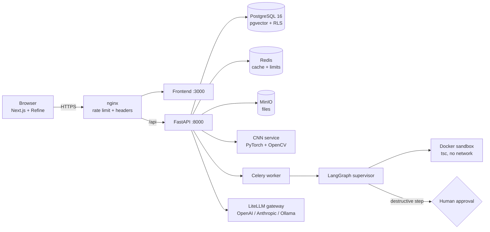
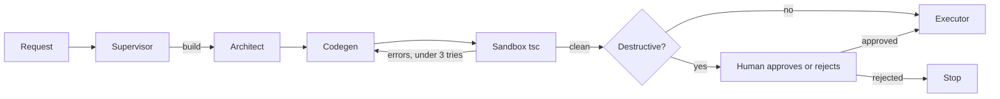

<div align="center">

# NEXUS · Refine-Nexus AI

**Autonomous admin-panel generator and intelligent operations OS.**
Feed it an API spec, a JSON sample or a CSV. Get a typed, secure admin panel with an agentic copilot that asks before it acts.

[](https://github.com/Nikhil-creat/nexus-ai-platform/actions/workflows/ci.yml)


[Live demo](#live-demo) · [Features](#features) · [Architecture](#architecture) · [Quick start](#quick-start) · [Security](#security-model) · [Roadmap](#roadmap)

</div>

---

## Why this exists

Every internal tool starts the same way: someone hand-builds tables, forms, permissions and audit logs on top of an API. NEXUS automates that. It infers schemas and relations, scaffolds a Refine admin, and layers on the parts teams usually bolt on later: role-based access, human approval for risky actions, hybrid retrieval over your own documents, document vision, cost tracking and a tamper-evident audit trail.

## Live demo

Deploy the `frontend/` folder to Vercel (see [Deploy](#deploy-frontend-on-vercel)) and open it. No backend is needed for the demo.

| Step | Where | What to try |
|---|---|---|
| 1 | Landing page | The hero video, responsive menu, `Cmd/Ctrl+K` palette |
| 2 | `/login` | Any valid email, password `nexus-demo` |
| 3 | Overview | KPIs read through a Refine data provider |
| 4 | Users / Orders | Sort, filter, CSV export, delete. Switch role in the sidebar and watch actions lock |
| 5 | Schema Studio | Click **Load sample**, then **Analyze** |
| 6 | Knowledge | Ask "who can delete records?" or "refund over 10000" |
| 7 | Audit trail | Append entries, then press **Tamper (test)** and watch the chain break |
| 8 | Workflows | Run the default rules against live orders |
| 9 | Copilot (bottom right) | Type "delete all inactive users" and see the approval gate |

## Features

| Area | What it does |
|---|---|
| **Schema auto-detection** | Parses OpenAPI 3.x, JSON and CSV. Detects keys, relations, enums, nullable fields and semantic widgets (`avatar_url` is an image, `status` is a badge, `created_at` is a datetime). Emits Refine resources and Zod schemas. |
| **Multi-agent engine** | LangGraph supervisor with architect and codegen agents, a Docker sandbox that runs `tsc` and retries up to three times, then a human approval gate before anything destructive. |
| **Hybrid RAG** | Dense vectors (pgvector) plus keyword search (full-text and trigram), fused with Reciprocal Rank Fusion and reranked by a cross-encoder. The browser demo uses BM25 plus hashed vectors with the same fusion. |
| **CNN vision** | PyTorch classifier for invoices, IDs and shipping labels, OpenCV preprocessing, OCR field extraction, and a 1D convolution spike detector for metrics. |
| **Nexus Copilot** | Context-aware drawer (route, record, role), streaming answers over SSE, voice input, PII masking, prompt-injection screening. DELETE, UPDATE, migrations and webhooks always wait for approval. |
| **Access control** | Role matrix (admin, editor, viewer) enforced in FastAPI and in Refine's `accessControlProvider`. Attribute rules for tenant and owner. |
| **Audit trail** | Append-only log where each entry stores the SHA-256 of the previous one. Editing history breaks the chain at that entry. Database triggers block UPDATE and DELETE. |
| **FinOps** | Token, cost and cache-hit tracking per user, with semantic caching to avoid repeat spend. |
| **Workflows** | Condition-and-action rules evaluated against live data. |
| **Platform polish** | Command palette, theme studio, offline PWA cache, security headers, `robots.txt`, sitemap, 404 page, CSV and JSON export. |

### Demo mode versus full stack

| Capability | Vercel demo (no backend) | Docker full stack |
|---|---|---|
| Admin tables, RBAC, CSV export | In-memory sample data | Your REST API through `NEXT_PUBLIC_REST_URL` |
| Schema Studio | JSON and CSV and OpenAPI JSON in the browser | Also YAML through `/schema/inspect` |
| Knowledge search | In-browser BM25 plus vectors | pgvector plus cross-encoder reranker |
| Audit trail | Hash chain in browser storage | Postgres `audit_log` with immutability triggers |
| Copilot | Local replies and approval gate | Streaming LLM through LiteLLM |
| Document intelligence | Not available | CNN service |

## Architecture





### Repository layout

```
frontend/      Next.js 15, React 19, Refine, all pages and components
backend/       FastAPI app, security, audit, RAG, worker, tests
ai_workers/    LangGraph supervisor graph
cnn_service/   PyTorch document classifier and anomaly detector
infra/         nginx.conf and init.sql (extensions, RLS, immutable audit)
.github/       CI workflow, issue and PR templates, Dependabot
```

## Tech stack

| Layer | Tools |
|---|---|
| Frontend | Next.js 15 (App Router), React 19, Refine, TanStack Query, Zustand, Zod, TypeScript |
| Backend | Python 3.12, FastAPI, Celery, SQLAlchemy, PyJWT |
| AI | LangGraph, LiteLLM, sentence-transformers, cross-encoder reranking |
| Vision | PyTorch, OpenCV, Tesseract |
| Data | PostgreSQL 16 with pgvector and pg_trgm, Redis, MinIO |
| Infra | Docker, Docker Compose, nginx, GitHub Actions |

## Quick start

### Frontend only

```bash
cd frontend
npm install
npm run dev        # http://localhost:3000
```

### Full stack with Docker

```bash
cp .env.example .env
# edit .env: POSTGRES_PASSWORD, JWT_SECRET (openssl rand -hex 32), MINIO_ROOT_PASSWORD, DEMO_ADMIN_PASSWORD
docker compose up --build -d
docker compose ps
```

App at http://localhost, API docs at http://localhost/api/docs, MinIO console at http://127.0.0.1:9001.

Try the schema API:

```bash
TOKEN=$(curl -s localhost/api/auth/login -H 'content-type: application/json' \
  -d '{"email":"admin@nexus.dev","password":"<DEMO_ADMIN_PASSWORD>"}' | python3 -c 'import sys,json;print(json.load(sys.stdin)["access_token"])')
curl -s localhost/api/schema/inspect -H "authorization: Bearer $TOKEN" \
  -d '{"id":1,"email":"a@b.com","status":"active","avatar_url":"https://x/y.png"}'
```

### Run the tests

```bash
pip install fastapi pyjwt pyyaml pytest
cd backend && python -m pytest -q tests
```

## Configuration

| Variable | Where | Purpose |
|---|---|---|
| `POSTGRES_PASSWORD` | `.env` | Database password |
| `JWT_SECRET` | `.env` | Token signing key, at least 16 characters |
| `MINIO_ROOT_USER`, `MINIO_ROOT_PASSWORD` | `.env` | Object storage credentials |
| `DEMO_ADMIN_PASSWORD` | `.env` | Password for the demo login endpoint |
| `LITELLM_MODEL` | `.env` | Default model, for example `gpt-4o-mini` |
| `OPENAI_API_KEY`, `ANTHROPIC_API_KEY` | `.env` | Optional. Leave blank for offline demo replies |
| `ALLOWED_ORIGINS` | `.env` | CORS origins, set to your frontend URL |
| `NEXT_PUBLIC_API_URL` | frontend | Deployed FastAPI base URL. Empty means demo mode |
| `NEXT_PUBLIC_REST_URL` | frontend | Point Refine at a real REST API |
| `NEXT_PUBLIC_SITE_URL` | frontend | Public URL, used by the sitemap |

## API reference

| Method | Path | Role | Purpose |
|---|---|---|---|
| GET | `/health` | public | Liveness and Redis status |
| POST | `/auth/login` | public | Issue a JWT |
| POST | `/schema/inspect` | admin, editor | Infer resources from a spec or sample |
| POST | `/copilot/stream` | any | Streaming copilot over SSE |
| POST | `/copilot/approve/{id}` | admin | Approve or reject a pending action |
| POST | `/documents/extract` | admin, editor | Classify a document image and extract fields |
| GET | `/finops/summary` | any | Token and cost telemetry |
| GET | `/audit` | any | Recent entries plus chain verification |

## Security model

- **Authentication and authorization:** JWT, role matrix, tenant and owner attribute checks. The server is the source of truth; the UI only mirrors it.
- **Human in the loop:** delete, update, migrate, webhook and bulk update need explicit approval, recorded in the audit chain.
- **Data protection:** emails, phone numbers, card numbers and Aadhaar-style IDs are masked before text reaches an external model.
- **Prompt safety:** injection heuristics reject known override patterns. The analyst SQL guard allows a single read-only SELECT.
- **Isolation:** generated code runs with no network, a read-only filesystem and capped CPU, memory and processes. Postgres row-level security isolates tenants.
- **Containers:** non-root users, dropped capabilities, `no-new-privileges`, nginx rate limiting and security headers.
- **Tamper evidence:** hash-chained audit entries and database triggers that refuse updates and deletes.

Report vulnerabilities as described in [SECURITY.md](SECURITY.md).

## Known limitations

Be honest about what this is: a strong portfolio-grade foundation, not a finished SaaS.

- The demo login and sample data are for evaluation only. Connect a real identity provider (OIDC) and store tokens in httpOnly cookies before real use.
- The backend audit chain, pending approvals and semantic cache are in memory. Persist them to Postgres and Redis for production.
- The CNN ships without trained weights. Responses are flagged `model_trained: false` and routed to human review.
- LLM features need an API key or a local Ollama model. Without one the copilot answers in offline demo mode.
- Uploads are limited to PNG and JPEG up to 10 MB. Prompts are limited to 4,000 characters.

## Push to GitHub from your phone (Termux)

```bash
pkg update -y && pkg upgrade -y
pkg install -y git gh unzip
termux-setup-storage
cd ~ && unzip ~/storage/downloads/refine-nexus-ai.zip && cd refine-nexus-ai
git config --global user.name  "Your Name"
git config --global user.email "you@example.com"
gh auth login && gh auth setup-git
git init -b main && git add . && git status
git commit -m "Initial commit"
gh repo create nexus-ai-platform --public --source=. --remote=origin --push
```

Later changes: `git add . && git commit -m "message" && git push`.

## Deploy frontend on Vercel

1. Open vercel.com, sign in with GitHub, then **Add New → Project** and import this repo.
2. Set **Root Directory** to `frontend`.
3. Leave environment variables empty for the demo, then press **Deploy**.
4. Every push to `main` redeploys.

Vercel hosts the frontend only. Run the Python services on Render, Railway, Fly.io or a VPS with `docker compose`, then set `NEXT_PUBLIC_API_URL` in Vercel and `ALLOWED_ORIGINS` on the backend.

## Roadmap

- [x] Schema auto-detection, Refine admin, RBAC
- [x] Hybrid RAG, audit chain, workflows, copilot with approval gate
- [x] Docker stack, CI, tests
- [ ] Persist audit, approvals and cache in Postgres and Redis
- [ ] OIDC sign-in (Google, GitHub) and WebAuthn passkeys
- [ ] Real-time presence and optimistic locking over WebSockets
- [ ] Trained CNN weights and an evaluation report
- [ ] Postgres and MySQL live introspection for schema detection
- [ ] Visual workflow canvas and signed webhooks
- [ ] OpenTelemetry, Prometheus and Grafana dashboards
- [ ] Playwright end-to-end tests

## Contributing

See [CONTRIBUTING.md](CONTRIBUTING.md). Issues and pull requests are welcome.

## Author

**Nikhil Chary Sriramoju**, final-year B.Tech CSE student at Vaagdevi College of Engineering, Warangal.
[GitHub](https://github.com/Nikhil-creat) · [LinkedIn](https://in.linkedin.com/in/nikhil-chary-sriramoju-95041b38a)

## License

[MIT](LICENSE)
